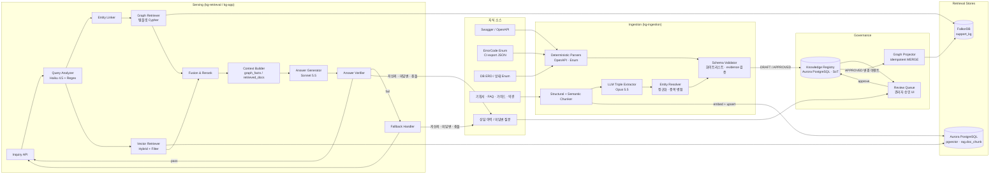
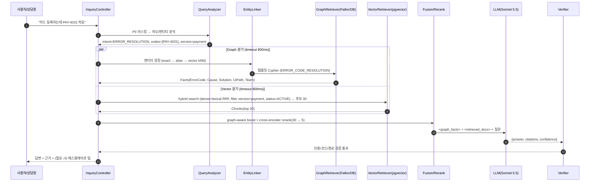
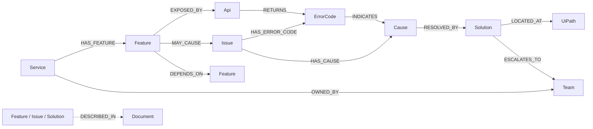
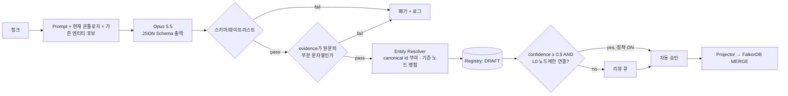
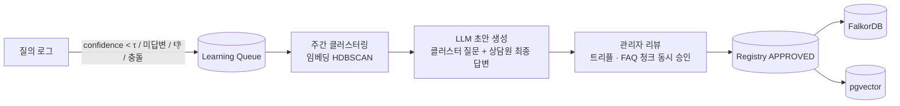

# Hybrid GraphRAG 설계서 — 서비스 문의 대응 (FalkorDB + Vector DB)

> 목표: 상담원/챗봇이 소스 코드를 보지 않고도 **서비스 구조 → 기능 → 오류 코드 → 원인 → 조치 → UI 경로**를 정확히 답하게 한다.
> 원칙: **구조적 사실은 그래프가, 설명·뉘앙스는 문서가 책임진다. LLM은 사실을 만들지 않고 "말로 옮기기만" 한다.**
>
> 이 문서는 이후 샘플 코드(`hybrid-graphrag/`) 구현의 기준 문서다. 0장은 초안 대비 변경·추가 제안을 요약한 것이다.

---

## 0. 초안 대비 핵심 제안 요약

| # | 제안 | 이유 |
|---|---|---|
| P1 | **`:Cause` 노드 추가** — `Issue → Cause → Solution` | 같은 증상(결제 실패)에도 원인(한도 초과/카드 만료/PG 장애)별로 조치가 다르다. `Issue -[:REQUIRES]-> Solution` 직결은 "원인과 무관한 조치"를 섞어서 답하게 만든다. |
| P2 | **`:Api` 노드 추가** — `Feature -[:EXPOSED_BY]-> Api -[:RETURNS]-> ErrorCode` | Swagger·Enum에서 **LLM 없이 결정적으로** 뽑을 수 있는 가장 신뢰도 높은 뼈대. 오류 코드가 어느 서비스/기능에서 나는지 역추적이 가능해진다. |
| P3 | **`ErrorCode -[:INDICATES]-> Cause`** | 오류 코드는 이슈보다 원인을 더 정확히 가리킨다. 오류 코드가 질문에 있으면 원인까지 1-hop으로 확정된다. |
| P4 | **`UI_Path`를 문자열 대신 구조화** (`steps: [...]`, `platform`, `min_app_version`, `deeplink`) | "앱/웹 경로가 다르다", "구버전은 메뉴 위치가 다르다" 같은 문의가 많다. 단계 리스트여야 검증기(9장)가 답변 속 경로를 대조할 수 있다. |
| P5 | **`:Team`(에스컬레이션), `:Document`(문서 브릿지) 노드 추가** | 그래프로 해결 못 하면 "누구에게 넘길지"도 사실이어야 한다. `Document`는 그래프 ↔ 벡터 청크를 잇는 양방향 키다. |
| P6 | **모든 노드/엣지에 거버넌스 속성** (`status`, `confidence`, `source`, `source_ref`, `version`, `updated_at`) | 검색은 `status='APPROVED'`만 사용한다. LLM이 추출한 지식은 무조건 `DRAFT`로 들어가서 승인 전에는 답변에 쓰이지 않는다. 환각 방지의 핵심 장치다. |
| P7 | **Knowledge Registry(PostgreSQL)를 원본(SoT)으로 두고 FalkorDB는 투영(projection)으로 운용** | FalkorDB는 인메모리다. 승인 이력·감사·롤백·전체 재빌드를 위해 원본은 RDB에 두고, FalkorDB는 언제든 다시 만들 수 있는 조회 전용 뷰로 운용한다. |
| P8 | **Text2Cypher 대신 "Query Analyzer + Entity Linking + 템플릿 Cypher"** | LLM이 Cypher를 즉석에서 만들면 오류·지연·보안 위험이 생긴다. 의도별로 미리 검증한 파라미터화 쿼리만 실행한다(`GRAPH.RO_QUERY`). |
| P9 | **엔티티 링킹에 FalkorDB 벡터 인덱스 사용** | GraphRAG에서 가장 어려운 부분은 "질문 → 시작 노드" 매핑이다. `Issue`/`Feature` 노드에 임베딩을 저장하고 FalkorDB 안에서 바로 kNN을 수행한다. |
| P10 | **Graph-aware Fusion + Reranker** | 단순 이어붙이기가 아니라, 그래프 결과에 연결된 문서 청크(`entity_ids` 교집합)를 가산점 처리한 뒤 Cross-encoder로 재정렬한다. |
| P11 | **Answer Verifier(결정적 사후 검증)** | 답변에 나온 오류 코드·UI 경로·인용 ID가 컨텍스트에 실제로 있는지 코드로 검사한다. 통과하지 못하면 재생성하거나 Fallback으로 넘긴다. |
| P12 | **Graph-vs-Doc 충돌을 "문서 노후화 신호"로 활용** | 충돌이 나면 그래프를 우선하는 것에서 끝내지 않고, 충돌 이벤트를 리뷰 큐에 넣어 오래된 문서를 고친다. |
| P13 | **한국어 하이브리드 검색** — Dense(BGE-M3) + Lexical(Nori 형태소 토큰 → `tsvector`) | 오류 코드·메뉴명 같은 정확한 토큰은 Dense 임베딩만으로 놓치기 쉽다. pgvector 결과와 키워드 결과를 SQL 안에서 RRF로 융합한다. |
| P17 | **Vector DB를 Aurora PostgreSQL(pgvector)로 통합** | Registry와 같은 클러스터를 써서 운영할 시스템이 줄고, 승인과 청크 메타데이터 갱신을 한 트랜잭션으로 처리할 수 있다(3.0). |
| P14 | **"Graph as Code"** — 오류 코드 Enum/Swagger를 CI에서 자동 동기화 | 배포될 때마다 오류 코드와 API가 그래프에 반영되므로 지식 노후화가 구조적으로 줄어든다. |
| P15 | **상담원 보조(Agent-Assist) 모드 먼저 출시 → 고객 챗봇은 그다음** | 초기 정확도가 낮을 때 위험을 줄일 수 있다. 상담원 피드백(👍/👎, 수정본)은 Active Learning의 가장 좋은 학습 데이터다. |
| P16 | **평가 파이프라인(Golden Set) + 관측성(Trace)** | 프롬프트·스키마·모델을 바꿀 때 회귀 여부를 수치로 확인한다. |

---

## 1. 시스템 아키텍처

### 1.1 전체 구성도



### 1.2 질의 처리 흐름 (Sequence)



Vector 분기는 링킹 결과를 기다리지 않고 즉시 시작한다. Graph 분기만 `Analyzer → Linker → Cypher` 순서를 따른다. 링커가 서비스를 확정하면 Vector 결과는 사후 필터로 다시 걸러낸다.

### 1.3 기술 선택

| 영역 | 선택 | 근거 |
|---|---|---|
| Backend | Kotlin 2.x, Spring Boot 3.x, JDK 21, Coroutines | 요구사항. 병렬 검색과 timeout은 `coroutineScope` + `withTimeoutOrNull`로 처리한다. |
| Graph DB | FalkorDB + **JFalkorDB** 클라이언트 | 인메모리이고 Cypher를 쓴다. 노드 벡터 인덱스를 지원하며, `GRAPH.RO_QUERY`로 조회를 읽기 전용으로 강제할 수 있다. |
| Vector DB | **Aurora PostgreSQL + pgvector 0.8+** | Registry와 같은 클러스터를 써서 트랜잭션 일관성을 지키고 운영 대상을 줄인다. 검색은 reader endpoint로 보낸다. 대규모로 커지면 Qdrant로 옮길 수 있다(3.0). |
| Framework | **Spring AI** (ChatClient, Structured Output, Anthropic 연동) + **검색은 직접 구현(JdbcClient SQL, JFalkorDB)** | Spring AI의 `PgVectorStore`는 dense 검색만 지원하고, 키워드 RRF·graph-aware 필터를 표현할 수 없다. 그래서 검색은 포트/어댑터로 직접 구현하고, LLM 호출만 Spring AI로 한다. 이 경계 덕분에 LangChain4j로 바꾸기도 쉽다. |
| LLM | 생성 **Claude Sonnet 5.5**, 분석·분류 **Claude Haiku 4.5**, 오프라인 트리플 추출 **Claude Opus 5.5** | 실시간 경로는 지연과 비용을, 오프라인 추출은 정확도를 우선한다. |
| Embedding | **BGE-M3** (1024d, 다국어·한국어 강함, TEI로 셀프 호스팅) | 포트로 추상화하므로 다른 모델로 바꿀 수 있다. 노드 임베딩과 청크 임베딩은 **같은 모델**을 써야 한다. Nemotron(2048/4096)은 보류했다. 다시 도입하려면 4096차원이 pgvector HNSW 한도를 넘는 문제부터 풀어야 한다(`halfvec` 최대 4000 → Matryoshka 2048 후보 검색 + 4096 재점수). |
| Lexical | Lucene **Nori** 형태소 분석 → `to_tsvector('simple', tokens)` + GIN | 한국어 조사·어미를 분리해야 키워드 매칭이 제대로 된다. Aurora에서 확장 설치 없이 동작한다(3.2). |
| Reranker | `bge-reranker-v2-m3` (TEI) — **잠정** | 한국어 cross-encoder. Reranker는 질의와 문서를 함께 입력받는 cross-encoder여야 한다. Nemotron Embed 같은 임베딩 모델(bi-encoder)은 reranker 역할을 하지 못한다. Qwen3-Reranker, NVIDIA rerank 계열과 Golden Set으로 비교한 뒤 확정한다. |
| Registry/Queue | PostgreSQL 16 (+ Flyway) | SoT, 승인 워크플로, 감사 로그, Outbox. |

---

## 2. 온톨로지 (FalkorDB) — 개선안

### 2.1 스키마



| 레이블 | 핵심 속성 (공통 속성 제외) | 비고 |
|---|---|---|
| `Service` | `name`, `description` | 예: `svc:payment` |
| `Feature` | `name`, `description`, `aliases[]`, `embedding` | 링킹 대상. Swagger tag 기반 |
| `Api` | `method`, `path`, `operation_id`, `summary` | Swagger에서 결정적으로 생성 |
| `ErrorCode` | `code`, `http_status`, `message`, `user_message` | `code`는 정확 매칭 인덱스를 둔다 |
| `Issue` | `title`, `symptom`, `aliases[]`, `severity`, `embedding` | **사용자 언어**로 표현한 증상. 링킹 대상 |
| `Cause` | `description`, `check_method`, `likelihood_hint` | "어떻게 확인하는가"를 함께 저장 |
| `Solution` | `title`, `steps[]`, `audience`(`CUSTOMER`/`AGENT`/`INTERNAL`), `eta` | 고객 노출 여부를 `audience`로 제어 |
| `UiPath` | `platform`(`APP`/`WEB`/`ADMIN`), `steps[]`, `min_app_version`, `deeplink` | 초안의 `UI_Path`. 라벨 컨벤션에 맞춰 `UiPath`로 명명 |
| `Team` | `name`, `channel`, `hours` | 에스컬레이션 대상 |
| `Document` | `title`, `url`, `doc_type` | `rag.doc_chunk.doc_id`와 같은 키 |

| 관계 | 속성 |
|---|---|
| `RETURNS` | `http_status` |
| `HAS_CAUSE` | `likelihood`(0~1) — 원인 후보 정렬용 |
| `RESOLVED_BY` | `priority`(1이 먼저), `condition`("한도 초과인 경우") |
| `DEPENDS_ON` | `kind`(`SYNC`/`ASYNC`) — 장애 영향 범위 질의용 |

**공통 속성 (모든 노드·엣지)**

```
id            : 'issue:payment:card-register-fail'   # 결정적 canonical id (MERGE 키)
status        : 'DRAFT' | 'APPROVED' | 'DEPRECATED'
confidence    : 0.0 ~ 1.0
source        : 'OPENAPI' | 'ENUM' | 'LLM_EXTRACT' | 'MANUAL' | 'ACTIVE_LEARNING'
source_ref    : 'payment-api.yaml#/paths/~1cards/post' | 'doc:faq-payment#chunk-12'
version       : 3
updated_at    : epoch millis
```

**canonical id 규칙**: `{label 약어}:{service}:{kebab-slug}`. 예: `err:PAY-4031`, `feat:payment:card-register`, `sol:payment:reissue-card`. 오류 코드는 전사에서 유일하므로 서비스를 붙이지 않는다. ID를 결정적으로 만들어야 재추출해도 노드가 중복되지 않는다.

**확장 후보 (MVP 이후)**: `:State`(주문/결제 상태 Enum, ERD에서 추출), `:Policy`(약관의 정량 규칙, 예: "환불 7일 이내"), `:Release`(기능 도입 버전).

### 2.2 FalkorDB 스키마 정의 쿼리

```cypher
// ── Range index (MERGE / 정확 매칭 키)
CREATE INDEX FOR (n:Service)   ON (n.id)
CREATE INDEX FOR (n:Feature)   ON (n.id)
CREATE INDEX FOR (n:Api)       ON (n.id)
CREATE INDEX FOR (n:ErrorCode) ON (n.id)
CREATE INDEX FOR (n:ErrorCode) ON (n.code)
CREATE INDEX FOR (n:Issue)     ON (n.id)
CREATE INDEX FOR (n:Cause)     ON (n.id)
CREATE INDEX FOR (n:Solution)  ON (n.id)
CREATE INDEX FOR (n:UiPath)    ON (n.id)
CREATE INDEX FOR (n:Team)      ON (n.id)
CREATE INDEX FOR (n:Document)  ON (n.id)

// ── Vector index (엔티티 링킹, BGE-M3 = 1024d)
CREATE VECTOR INDEX FOR (n:Issue)   ON (n.embedding) OPTIONS {dimension:1024, similarityFunction:'cosine'}
CREATE VECTOR INDEX FOR (n:Feature) ON (n.embedding) OPTIONS {dimension:1024, similarityFunction:'cosine'}
```

```bash
# 유일성 제약 (Cypher가 아닌 Redis 명령, 위 range index가 선행돼야 함)
GRAPH.CONSTRAINT CREATE support_kg UNIQUE NODE Issue PROPERTIES 1 id
# ... 레이블별 반복
```

> FalkorDB full-text 인덱스(RediSearch)는 한국어 형태소 분석을 지원하지 않는다. 그래서 키워드 링킹은 `aliases` 정확 매칭과 벡터 kNN으로 처리하고, full-text는 쓰지 않는다.

### 2.3 Upsert 쿼리 (Projector가 사용)

레이블과 관계 타입은 파라미터로 넘길 수 없다. 그래서 **enum 화이트리스트에서만** 문자열을 조립하고, 값은 항상 파라미터로 바인딩한다.

```cypher
// 노드 upsert
MERGE (n:Issue {id: $id})
ON CREATE SET n.created_at = timestamp()
SET n += $props, n.updated_at = timestamp()

// 임베딩 갱신
MATCH (n:Issue {id: $id}) SET n.embedding = vecf32($vec)

// 엣지 upsert
MATCH (a:Issue {id: $src}), (b:Cause {id: $dst})
MERGE (a)-[r:HAS_CAUSE]->(b)
SET r += $props, r.updated_at = timestamp()

// 폐기(삭제 대신 상태 변경 → 감사 추적 유지)
MATCH (n:Solution {id: $id}) SET n.status = 'DEPRECATED', n.updated_at = timestamp()
```

### 2.4 초기(Seed) 데이터 예시

```cypher
CREATE
 (s:Service  {id:'svc:payment', name:'결제', status:'APPROVED', confidence:1.0, source:'MANUAL'}),
 (t:Team     {id:'team:payment-ops', name:'결제운영팀', channel:'#payment-ops', hours:'평일 09-18', status:'APPROVED'}),
 (f:Feature  {id:'feat:payment:card-register', name:'카드 등록', aliases:['카드 추가','결제수단 등록'],
              description:'간편결제용 신용/체크카드를 등록한다', status:'APPROVED', confidence:1.0, source:'OPENAPI'}),
 (a:Api      {id:'api:payment:POST:/v1/cards', method:'POST', path:'/v1/cards', operation_id:'registerCard', status:'APPROVED', source:'OPENAPI'}),
 (e1:ErrorCode {id:'err:PAY-4031', code:'PAY-4031', http_status:422, message:'CARD_DECLINED_BY_ISSUER',
                user_message:'카드사에서 승인이 거절되었습니다', status:'APPROVED', source:'ENUM'}),
 (e2:ErrorCode {id:'err:PAY-4032', code:'PAY-4032', http_status:422, message:'CARD_EXPIRED',
                user_message:'유효기간이 지난 카드입니다', status:'APPROVED', source:'ENUM'}),
 (i:Issue    {id:'issue:payment:card-register-fail', title:'카드 등록 실패',
              symptom:'카드 등록 시 오류 메시지가 뜨고 등록이 안 됨', aliases:['카드 등록 안돼요','카드 추가 실패'],
              severity:'MEDIUM', status:'APPROVED', confidence:0.95, source:'LLM_EXTRACT'}),
 (c1:Cause   {id:'cause:payment:issuer-declined', description:'카드사에서 온라인 결제/해외결제 차단 또는 한도 초과',
              check_method:'카드사 앱에서 온라인 결제 허용 여부 확인', status:'APPROVED'}),
 (c2:Cause   {id:'cause:payment:card-expired', description:'카드 유효기간 만료', check_method:'카드 실물 유효기간 확인', status:'APPROVED'}),
 (so1:Solution {id:'sol:payment:enable-online-pay', title:'카드사 온라인 결제 허용',
                steps:['카드사 앱 실행','온라인/간편결제 허용 설정','다시 카드 등록 시도'], audience:'CUSTOMER', status:'APPROVED'}),
 (so2:Solution {id:'sol:payment:register-new-card', title:'유효한 카드로 재등록',
                steps:['기존 카드 삭제','새 카드 정보로 재등록'], audience:'CUSTOMER', status:'APPROVED'}),
 (u1:UiPath  {id:'ui:payment:card-manage:app', platform:'APP', steps:['마이페이지','결제수단 관리','카드 추가'],
              min_app_version:'5.2.0', deeplink:'myapp://payment/cards', status:'APPROVED'}),
 (s)-[:HAS_FEATURE]->(f), (s)-[:OWNED_BY]->(t),
 (f)-[:EXPOSED_BY]->(a),
 (a)-[:RETURNS {http_status:422}]->(e1), (a)-[:RETURNS {http_status:422}]->(e2),
 (f)-[:MAY_CAUSE]->(i),
 (i)-[:HAS_ERROR_CODE]->(e1), (i)-[:HAS_ERROR_CODE]->(e2),
 (i)-[:HAS_CAUSE {likelihood:0.7}]->(c1), (i)-[:HAS_CAUSE {likelihood:0.3}]->(c2),
 (e1)-[:INDICATES]->(c1), (e2)-[:INDICATES]->(c2),
 (c1)-[:RESOLVED_BY {priority:1}]->(so1), (c2)-[:RESOLVED_BY {priority:1}]->(so2),
 (so2)-[:LOCATED_AT]->(u1),
 (so1)-[:ESCALATES_TO]->(t)
```

### 2.5 조회 쿼리 세트 (템플릿 카탈로그)

모든 조회는 `GRAPH.RO_QUERY`로 실행하고, `status='APPROVED'` 필터와 `audience` 필터를 반드시 포함한다.

**Q-LINK-1. 오류 코드 정확 매칭**
```cypher
MATCH (e:ErrorCode) WHERE e.code IN $codes AND e.status = 'APPROVED'
RETURN e.id AS id, e.code AS code
```

**Q-LINK-2. 벡터 링킹 (Issue/Feature 공통, 레이블만 교체)**
```cypher
CALL db.idx.vector.queryNodes('Issue', 'embedding', $k, vecf32($vec)) YIELD node, score
WHERE node.status = 'APPROVED'
RETURN node.id AS id, node.title AS title, score
// score는 거리값(작을수록 유사). 링커에서 similarity = 1 - score 로 정규화
```

**Q-GRAPH-1. ERROR_CODE_RESOLUTION** — 오류 코드 → 소속 기능 → 원인 → 조치 → UI 경로 → 에스컬레이션
```cypher
MATCH (e:ErrorCode) WHERE e.code IN $codes AND e.status = 'APPROVED'
OPTIONAL MATCH (s:Service)-[:HAS_FEATURE]->(f:Feature)-[:EXPOSED_BY]->(:Api)-[:RETURNS]->(e)
WITH e, collect(DISTINCT {service: s.name, feature: f.name, feature_id: f.id}) AS owners
OPTIONAL MATCH (e)-[:INDICATES]->(c:Cause)-[r:RESOLVED_BY]->(sol:Solution)
  WHERE c.status = 'APPROVED' AND sol.status = 'APPROVED' AND sol.audience IN $audiences
OPTIONAL MATCH (sol)-[:LOCATED_AT]->(ui:UiPath) WHERE ui.status = 'APPROVED'
OPTIONAL MATCH (sol)-[:ESCALATES_TO]->(t:Team)
RETURN e.id AS error_id, e.code AS code, e.user_message AS user_message, owners,
       c.id AS cause_id, c.description AS cause, c.check_method AS check_method,
       sol.id AS solution_id, sol.title AS solution, sol.steps AS solution_steps,
       r.priority AS priority, r.condition AS condition,
       collect(DISTINCT {id: ui.id, platform: ui.platform, steps: ui.steps, min_app_version: ui.min_app_version}) AS ui_paths,
       t.name AS escalation_team, t.channel AS escalation_channel
ORDER BY code, priority
LIMIT 20
```

**Q-GRAPH-2. ISSUE_RESOLUTION** — 링킹된 증상 → 원인 후보(가능성 순) → 조치
```cypher
MATCH (i:Issue) WHERE i.id IN $issueIds AND i.status = 'APPROVED'
OPTIONAL MATCH (s:Service)-[:HAS_FEATURE]->(f:Feature)-[:MAY_CAUSE]->(i)
OPTIONAL MATCH (i)-[hc:HAS_CAUSE]->(c:Cause) WHERE c.status = 'APPROVED'
OPTIONAL MATCH (c)-[r:RESOLVED_BY]->(sol:Solution) WHERE sol.status = 'APPROVED' AND sol.audience IN $audiences
OPTIONAL MATCH (sol)-[:LOCATED_AT]->(ui:UiPath)
OPTIONAL MATCH (i)-[:HAS_ERROR_CODE]->(e:ErrorCode)
RETURN i.id AS issue_id, i.title AS issue, s.name AS service, f.name AS feature,
       c.id AS cause_id, c.description AS cause, c.check_method AS check_method, hc.likelihood AS likelihood,
       sol.id AS solution_id, sol.title AS solution, sol.steps AS solution_steps, r.priority AS priority,
       collect(DISTINCT {id: ui.id, platform: ui.platform, steps: ui.steps}) AS ui_paths,
       collect(DISTINCT e.code) AS related_codes
ORDER BY likelihood DESC, priority
LIMIT 20
```

**Q-GRAPH-3. FEATURE_EXPLAIN** — 기능 구조 + 알려진 이슈
```cypher
MATCH (s:Service)-[:HAS_FEATURE]->(f:Feature) WHERE f.id IN $featureIds AND f.status = 'APPROVED'
OPTIONAL MATCH (f)-[:EXPOSED_BY]->(a:Api)
OPTIONAL MATCH (f)-[:MAY_CAUSE]->(i:Issue) WHERE i.status = 'APPROVED'
OPTIONAL MATCH (f)-[:DEPENDS_ON]->(dep:Feature)
RETURN s.name AS service, f.id AS feature_id, f.name AS feature, f.description AS description,
       collect(DISTINCT a.method + ' ' + a.path) AS apis,
       collect(DISTINCT i.title) AS known_issues,
       collect(DISTINCT dep.name) AS depends_on
```

**Q-GRAPH-4. IMPACT (장애 영향 범위, 상담원/운영용)**
```cypher
MATCH (f:Feature {id: $featureId})<-[:DEPENDS_ON*1..3]-(impacted:Feature)<-[:HAS_FEATURE]-(s:Service)
RETURN DISTINCT s.name AS service, impacted.name AS feature
```

**Q-GRAPH-5. 문서 브릿지** — 그래프 결과에 연결된 문서 ID (Fusion에서 가산점 계산용)
```cypher
MATCH (n)-[:DESCRIBED_IN]->(d:Document) WHERE n.id IN $nodeIds
RETURN n.id AS node_id, d.id AS doc_id
```

---

## 3. Vector DB (Aurora PostgreSQL + pgvector) 스키마

### 3.0 Qdrant 대신 PostgreSQL을 선택한 이유

- Knowledge Registry(SoT)와 **같은 Aurora 클러스터**를 쓴다. 운영할 시스템이 하나 줄어든다.
- 지식 승인과 청크 메타데이터(`entity_ids`, `kg_version`) 갱신을 **한 트랜잭션**으로 처리할 수 있다. Outbox는 FalkorDB 투영에만 필요하다.
- 문의 대응 문서 규모(수만~수십만 청크)는 pgvector HNSW로 충분히 처리할 수 있다.
- 검색 쿼리는 Aurora **reader endpoint**로 보내고, 인덱싱·승인은 writer로 보낸다.
- 청크가 수백만 건을 넘거나, 필터가 많은 조건에서 높은 QPS와 낮은 지연을 동시에 요구하게 되면 Qdrant로 옮긴다. 검색 로직은 `VectorSearchPort` 뒤에 있으므로 어댑터만 교체하면 된다.

**전제 조건**: pgvector **0.8.0 이상**(`SELECT extversion FROM pg_extension WHERE extname='vector'`)이어야 한다. 0.8부터 필터 조건에서 결과가 모자라는 문제를 iterative index scan으로 완화할 수 있다.

### 3.1 테이블

```sql
CREATE EXTENSION IF NOT EXISTS vector;
CREATE SCHEMA IF NOT EXISTS rag;

CREATE TABLE rag.doc_chunk (
  chunk_id      text PRIMARY KEY,                 -- 'doc:faq-payment#12'
  doc_id        text NOT NULL,                    -- FalkorDB :Document.id 와 같은 키
  doc_type      text NOT NULL,                    -- FAQ | GUIDE | TERMS | SPEC | TICKET_RESOLUTION
  title         text NOT NULL,
  section_path  text[] NOT NULL DEFAULT '{}',
  service_ids   text[] NOT NULL,
  category      text,
  entity_ids    text[] NOT NULL DEFAULT '{}',     -- 그래프 브릿지 키
  issue_id      text,                             -- 초안 호환용 대표 이슈
  audience      text NOT NULL,                    -- CUSTOMER | AGENT | INTERNAL
  status        text NOT NULL DEFAULT 'ACTIVE',   -- ACTIVE | SUPERSEDED
  lang          text NOT NULL DEFAULT 'ko',
  content       text NOT NULL,
  content_hash  text NOT NULL,
  kg_version    bigint NOT NULL DEFAULT 0,
  updated_at    timestamptz NOT NULL DEFAULT now(),
  valid_until   timestamptz,
  embedding     vector(1024) NOT NULL,            -- BGE-M3 dense
  lexical       tsvector NOT NULL                 -- Nori 형태소 토큰 (아래 3.2)
);

CREATE INDEX doc_chunk_embedding_hnsw ON rag.doc_chunk
  USING hnsw (embedding vector_cosine_ops) WITH (m = 16, ef_construction = 64);
CREATE INDEX doc_chunk_lexical_gin  ON rag.doc_chunk USING gin (lexical);
CREATE INDEX doc_chunk_service_gin  ON rag.doc_chunk USING gin (service_ids);
CREATE INDEX doc_chunk_entity_gin   ON rag.doc_chunk USING gin (entity_ids);
CREATE INDEX doc_chunk_filter_btree ON rag.doc_chunk (status, audience);
```

- `entity_ids`: 초안의 `issue_id`를 일반화한 **그래프 브릿지 키**다. 추출 단계에서 청크에 링킹된 노드 ID를 모두 넣는다. `issue_id`는 호환을 위해 대표값으로 남긴다.
- `content_hash`: 같은 내용이면 재임베딩하지 않는다(비용 절감).
- `status`: 문서를 개정하면 이전 청크는 `SUPERSEDED`로 바꾼다. 삭제하지 않고 필터로 제외한다.
- 1024차원은 pgvector HNSW 한도(`vector` 2000차원) 안이므로 별도 차원 축소가 필요 없다.

### 3.2 한국어 키워드 검색 — 확장 없이 Nori 토큰을 `tsvector('simple')`로 저장

PostgreSQL에는 한국어 전문 검색 parser가 없다. Aurora에서는 ParadeDB·PGroonga 같은 확장도 쓸 수 없다. 그래서 **형태소 분석은 애플리케이션(Lucene Nori)에서 하고**, DB에는 분석된 토큰만 `simple` 설정으로 넣는다.

```kotlin
// "카드를 등록하는데 PAY-4031이 떠요" → "카드 등록 pay-4031 뜨"
val tokens = noriAnalyzer.tokenize(text)                     // 조사·어미 제거, 품사 필터
// INSERT ... lexical = to_tsvector('simple', :tokens)
```

- 오류 코드(`PAY-4031`)는 Nori가 쪼개지 않도록 사전 처리 단계에서 정규식으로 보호한다.
- `ts_rank_cd`는 엄밀한 BM25가 아니지만, Dense 결과와 RRF로 순위만 합치므로 순위 신호로는 충분하다.

### 3.3 하이브리드 검색 쿼리 (Dense + Lexical → RRF)

```sql
-- 세션 설정 (트랜잭션 단위)
SET LOCAL hnsw.ef_search = 100;
SET LOCAL hnsw.iterative_scan = relaxed_order;   -- 필터 때문에 결과가 모자라는 문제 완화

WITH dense AS (
  SELECT chunk_id, row_number() OVER (ORDER BY embedding <=> :qvec) AS r
  FROM rag.doc_chunk
  WHERE status = 'ACTIVE' AND audience = ANY(:audiences)
    AND (:services::text[] IS NULL OR service_ids && :services)
  ORDER BY embedding <=> :qvec
  LIMIT 50
),
lexical AS (
  SELECT chunk_id, row_number() OVER (ORDER BY ts_rank_cd(lexical, q) DESC) AS r
  FROM rag.doc_chunk, to_tsquery('simple', :noriQuery) q       -- 'pay-4031 | 카드 & 등록'
  WHERE lexical @@ q AND status = 'ACTIVE' AND audience = ANY(:audiences)
    AND (:services::text[] IS NULL OR service_ids && :services)
  ORDER BY ts_rank_cd(lexical, q) DESC
  LIMIT 50
),
fused AS (
  SELECT chunk_id, sum(1.0 / (60 + r)) AS rrf
  FROM (SELECT * FROM dense UNION ALL SELECT * FROM lexical) u
  GROUP BY chunk_id
)
SELECT c.chunk_id, c.doc_id, c.title, c.section_path, c.service_ids, c.entity_ids,
       c.audience, c.updated_at, c.content, f.rrf
FROM fused f JOIN rag.doc_chunk c USING (chunk_id)
ORDER BY f.rrf DESC
LIMIT 30;                                                      -- → reranker 후보
```

후보는 30개를 뽑아 reranker에 넘기고, 최종 5개를 쓴다. reranker의 입력이 되므로 이 단계에서는 precision보다 **recall@30**이 중요하다.

### 3.4 청킹 전략

1. **구조 우선 분할**: Markdown/HTML 헤더, 표, 목록 단위로 먼저 자른다. FAQ는 **Q/A 한 쌍 = 청크 한 개**로 고정하고 크기 규칙을 적용하지 않는다.
2. **의미 분할**: 구조 블록이 800토큰을 넘으면 문장 임베딩 유사도가 급락하는 지점에서 자른다. 목표 크기 300~800토큰, overlap 10~15%.
3. **Contextual header**: 임베딩할 때 `"[결제 FAQ > 카드 등록 > 오류가 날 때]\n"`를 본문 앞에 붙인다. 청크 단독으로는 잃어버리는 맥락을 보완한다.
4. **약관(TERMS)**: 조항(제n조) 단위를 지키고 조항 번호를 `section_path`에 저장해서 인용할 수 있게 한다.

---

## 4. 모듈 / 패키지 구조 (Kotlin + Spring Boot)

헥사고날(포트/어댑터) 구조의 Gradle 멀티 모듈로 나눈다. 도메인과 검색 로직은 FalkorDB·PostgreSQL·Spring AI에 의존하지 않는다.

```
hybrid-graphrag/
├── settings.gradle.kts
├── build.gradle.kts                  # 공통 버전 카탈로그 (gradle/libs.versions.toml)
├── docker-compose.yml                # falkordb, postgres(pgvector/pgvector:pg16), tei(embed+rerank)
│
├── kg-domain/                        # 순수 Kotlin. 외부 의존성 0
│   └── com.example.kg.domain
│       ├── ontology/                 # NodeLabel, RelType, AllowedTriples(화이트리스트), CanonicalId
│       ├── model/                    # KgNode, KgEdge, Governance(status, confidence, source)
│       ├── query/                    # Intent, AnalyzedQuery, LinkedEntity
│       ├── retrieval/                # GraphFact, DocChunk, FusedContext, RetrievalTrace
│       ├── answer/                   # AnswerDraft, Citation, VerifiedAnswer, FallbackReason
│       └── port/                     # GraphReadPort, GraphWritePort, VectorSearchPort, VectorWritePort,
│                                     # EmbeddingPort, RerankPort, LlmPort, RegistryPort, ReviewQueuePort
│
├── kg-retrieval/                     # 온라인 질의 파이프라인 (도메인 서비스)
│   └── com.example.kg.retrieval
│       ├── analyze/                  # QueryAnalyzer (regex + LLM), PiiMasker
│       ├── link/                     # EntityLinker (exact → alias → vector)
│       ├── graph/                    # GraphRetriever, CypherTemplate(카탈로그), FactMapper
│       ├── vector/                   # VectorRetriever, LexicalTokenizer(인터페이스)
│       ├── fusion/                   # FusionRanker (graph-aware boost + RRF + rerank)
│       ├── context/                  # ContextBuilder (XML), TokenBudgeter
│       ├── generate/                 # AnswerGenerator, PromptTemplates
│       ├── verify/                   # AnswerVerifier
│       ├── fallback/                 # FallbackPolicy, DeterministicRenderer
│       └── HybridRagService.kt       # 오케스트레이터
│
├── kg-ingestion/                     # 오프라인/배치 파이프라인
│   └── com.example.kg.ingestion
│       ├── source/                   # OpenApiParser, ErrorEnumParser, DocumentLoader
│       ├── chunk/                    # StructuralChunker, SemanticChunker
│       ├── extract/                  # TripleExtractor(LLM), ExtractionPrompts, ExtractionResult
│       ├── resolve/                  # EntityResolver (정규화, alias, 임베딩 유사도 병합 후보)
│       ├── validate/                 # TripleValidator (스키마 + evidence substring 검사)
│       ├── review/                   # ReviewService (승인/반려/수정), ActiveLearningCollector
│       └── project/                  # GraphProjector (Registry → FalkorDB), DocIndexer (→ rag.doc_chunk)
│
├── kg-infra/                         # 어댑터 구현
│   └── com.example.kg.infra
│       ├── falkordb/                 # FalkorGraphAdapter (JFalkorDB, RO_QUERY), SchemaInitializer
│       ├── pgvector/                 # PgVectorSearchAdapter (JdbcClient, 하이브리드 RRF SQL, reader DataSource)
│       ├── llm/                      # SpringAiLlmAdapter (Anthropic, structured output)
│       ├── embed/                    # TeiEmbeddingAdapter, TeiRerankAdapter
│       ├── lexical/                  # NoriTokenizer (lucene-analysis-nori)
│       └── persistence/              # Registry/ReviewQueue (JdbcClient) + Flyway (schema: kg, rag)
│
└── kg-app/                           # Spring Boot 실행 모듈
    └── com.example.kg.app
        ├── api/                      # InquiryController, ReviewController, IngestionController
        ├── config/                   # 빈 조립, 타임아웃/임계값 Properties
        ├── job/                      # 스케줄러 (재인덱싱, Active Learning 클러스터링)
        └── observability/            # RetrievalTrace 로깅, 메트릭
```

의존 방향은 `kg-app → kg-retrieval, kg-ingestion → kg-domain ← kg-infra`이다. `kg-app`은 `kg-infra`를 런타임 조립용으로만 의존한다.

---

## 5. Cold-Start 지식 수집·추출 파이프라인

### 5.1 단계별 신뢰도 전략 — "결정적인 것부터 쌓는다"

| 단계 | 소스 | 방법 | 생성 노드/엣지 | 기본 status |
|---|---|---|---|---|
| L0 | ErrorCode Enum (CI export JSON) | 코드 파싱 | `ErrorCode` | **APPROVED** (confidence 1.0) |
| L0 | Swagger | 파서(`swagger-parser`) | `Service`, `Feature`(tag), `Api`, `RETURNS` | **APPROVED** |
| L1 | Swagger description + 기획서 | LLM 보강 | `Feature.description/aliases`, `Feature-[:DEPENDS_ON]` | DRAFT |
| L2 | FAQ·가이드·상담 해결 이력 | LLM Triple 추출 | `Issue`, `Cause`, `Solution`, `UiPath`, 엣지 | DRAFT → 리뷰 |
| L3 | 운영 중 미답변·저신뢰·👎 | Active Learning | 위와 동일 + FAQ 청크 | DRAFT → 리뷰 |

L0만으로도 "오류 코드 X는 어느 서비스의 어느 API에서 나는가"에 답할 수 있다. 첫날부터 쓸 수 있는 그래프가 생긴다.

**오류 코드 Enum 표준 export (각 서비스 CI에서 생성, 권장 포맷)**
```json
{ "service": "payment", "version": "2026.10.01",
  "errors": [ { "code": "PAY-4031", "httpStatus": 422, "name": "CARD_DECLINED_BY_ISSUER",
                "userMessage": "카드사에서 승인이 거절되었습니다", "operations": ["registerCard", "pay"] } ] }
```
Swagger에 `x-error-codes: [PAY-4031, ...]` 확장 필드를 붙이는 방식도 지원한다. 둘 다 없으면 응답 스키마의 enum 값을 파싱한다.

### 5.2 LLM 추출 → 검증 → 승인 흐름



**Entity Resolution 규칙**
1. 이름 정규화(공백·특수문자·대소문자) → 같은 레이블 안에서 `name`/`aliases` 정확 매칭
2. 임베딩 유사도 ≥ 0.92면 **병합 후보**로 리뷰 큐에 올린다(자동 병합하지 않음)
3. 오류 코드는 정규식 `[A-Z]{2,5}-\d{3,5}`로 정확 매칭만 한다

### 5.3 Active Learning Loop



- 큐에 넣는 기준: `final_confidence < 0.6`, 그래프 결과 0건, 검증 실패 후 Fallback, 상담원 👎, Graph-vs-Doc 충돌
- 큐 적재 전 **PII 마스킹**은 필수다(전화번호, 카드번호, 이메일, 주문번호 패턴).
- 상담원이 직접 작성한 최종 답변이 있으면 그것을 근거(evidence)로 삼아 트리플을 추출한다. 승인 품질이 크게 오른다.

---

## 6. LLM 프롬프트 — Triple 추출

### 6.1 Swagger(OpenAPI) 보강용

API/오류 코드 노드는 파서가 결정적으로 만든다. LLM은 **사람의 언어로 된 계층(Feature 묶음, 별칭, 의존, 잠재 이슈)** 만 추출한다.

```text
[SYSTEM]
너는 서비스 지식 그래프 구축 전문가다. 주어진 OpenAPI 조각을 읽고, 고객 문의 대응에 필요한
"기능(Feature)" 단위의 지식만 JSON으로 추출한다.

규칙:
1. 아래 <ontology>에 정의된 레이블/관계만 사용한다. 새 레이블을 만들지 않는다.
2. Api, ErrorCode 노드는 이미 존재한다. <existing_nodes>의 id를 그대로 참조하고 새로 만들지 않는다.
3. Feature는 "사용자가 인식하는 기능" 단위다(예: '카드 등록'). 엔드포인트 하나하나가 Feature가 아니다.
4. aliases에는 고객이 실제로 쓸 법한 표현을 2~5개 넣는다(구어체 포함).
5. Issue는 description/응답 코드에 근거가 명시된 것만 추출한다. 추측 금지.
6. 모든 항목에 evidence(원문에서 그대로 복사한 문장)를 단다. 원문에 없는 문장은 evidence로 쓸 수 없다.
7. 확신이 없으면 confidence를 낮게 매기고, 근거가 없으면 출력하지 않는다.

<ontology>
{{ontology_spec}}          # 레이블·속성·허용 (src,rel,dst) 목록
</ontology>

[USER]
<service>{{service_id}}</service>
<existing_nodes>
{{api_and_error_nodes_json}}   # [{id, label, name}]
</existing_nodes>
<openapi_fragment>
{{tag_group_yaml}}             # tag 단위로 묶은 paths + responses + descriptions
</openapi_fragment>

출력 JSON Schema를 따르라.
```

### 6.2 비정형 문서(FAQ·가이드·상담 이력)용

```text
[SYSTEM]
너는 고객지원 지식 그래프 추출기다. 문서에서 "증상 → 원인 → 조치 → 화면 경로" 지식을
트리플로 추출한다.

추출 원칙:
- Issue.title/symptom: 고객이 겪는 현상을 고객 언어로 적는다. ("카드 등록 실패")
- Cause: 그 현상이 일어나는 '이유' 하나. 여러 이유가 있으면 Cause를 나눈다.
- Solution.steps: 실행 가능한 동사형 단계 배열. 한 단계에 한 행동.
- Solution.audience: 고객이 직접 할 수 있으면 CUSTOMER, 상담원 권한이 필요하면 AGENT,
  개발/운영 조치면 INTERNAL.
- UiPath.steps: 화면에 표시되는 메뉴명을 원문 그대로 순서대로 적는다. 바꿔 말하지 않는다.
- 오류 코드는 원문에 표기된 그대로 적는다. 원문에 없는 오류 코드는 절대 만들지 않는다.
- 기존 엔티티(<candidates>)와 같은 대상이면 반드시 그 id를 재사용한다(ref_id).
- 모든 노드와 엣지에 evidence(원문 그대로 복사한 연속 문장)와 confidence(0~1)를 단다.
- 근거가 불충분하면 출력하지 않는다. 빈 배열도 정답이다.

허용 관계:
(Feature)-[MAY_CAUSE]->(Issue), (Issue)-[HAS_ERROR_CODE]->(ErrorCode),
(Issue)-[HAS_CAUSE]->(Cause), (ErrorCode)-[INDICATES]->(Cause),
(Cause)-[RESOLVED_BY]->(Solution), (Solution)-[LOCATED_AT]->(UiPath),
(Solution)-[ESCALATES_TO]->(Team)

[USER]
<document title="{{title}}" section="{{section_path}}" service="{{service_hint}}">
{{chunk_text}}
</document>
<candidates>
{{linked_existing_entities_json}}   # 청크 임베딩으로 미리 찾은 기존 노드 top-k
</candidates>
```

**출력 JSON Schema (두 프롬프트 공통, Structured Output으로 강제)**

```json
{
  "nodes": [
    { "temp_id": "n1", "ref_id": null, "label": "Issue",
      "properties": { "title": "카드 등록 실패", "symptom": "...", "aliases": ["카드 추가 안됨"] },
      "evidence": "카드 등록 시 '승인 거절' 메시지가 표시되는 경우", "confidence": 0.9 }
  ],
  "edges": [
    { "src": "n1", "rel": "HAS_CAUSE", "dst": "n2",
      "properties": { "likelihood": 0.7 },
      "evidence": "대부분 카드사의 온라인 결제 차단 설정 때문입니다", "confidence": 0.85 }
  ]
}
```
`src`/`dst`에는 `temp_id` 또는 기존 노드의 `ref_id`가 들어간다. 검증기는 (src 레이블, rel, dst 레이블) 조합이 화이트리스트에 있는지, `evidence`가 원문의 부분 문자열인지(공백 정규화 후) 검사한다.

---

## 7. 검색·병합 파이프라인 (Kotlin 핵심 로직)

### 7.1 Query Analyzer 출력

```kotlin
enum class Intent { ERROR_RESOLUTION, ISSUE_RESOLUTION, HOW_TO, FEATURE_EXPLAIN, POLICY, OTHER }

data class AnalyzedQuery(
    val original: String,
    val masked: String,                 // PII 마스킹본 — 이후 모든 단계는 이것만 사용
    val rewritten: String,              // 검색용 재작성 (구어체 → 표준어, 대명사 해소)
    val intent: Intent,
    val serviceHints: List<String>,     // svc:payment
    val errorCodes: List<String>,       // regex로 먼저 추출, LLM은 보조
    val keywords: List<String>,
)
```

오류 코드는 **정규식으로 먼저** 추출한다. 의도·재작성은 Haiku 4.5 structured output으로 얻는다. LLM 호출이 실패하면 규칙 기반 기본값(오류 코드가 있으면 `ERROR_RESOLUTION`, 없으면 `OTHER`)을 쓴다.

### 7.2 Entity Linker

```kotlin
class EntityLinker(
    private val graph: GraphReadPort,
    private val embedding: EmbeddingPort,
    private val props: LinkingProperties,   // minSimilarity = 0.75, k = 5
) {
    suspend fun link(q: AnalyzedQuery): List<LinkedEntity> = coroutineScope {
        val exactCodes = async { graph.findErrorCodes(q.errorCodes) }                // Q-LINK-1
        val vec = embedding.embed(q.rewritten)
        val issues = async { graph.vectorSearch(NodeLabel.ISSUE, vec, props.k) }     // Q-LINK-2
        val features = async { graph.vectorSearch(NodeLabel.FEATURE, vec, props.k) }

        (exactCodes.await().map { LinkedEntity(it, NodeLabel.ERROR_CODE, 1.0, LinkMethod.EXACT) } +
            (issues.await() + features.await())
                .filter { it.similarity >= props.minSimilarity }
                .map { LinkedEntity(it.id, it.label, it.similarity, LinkMethod.VECTOR) })
            .sortedByDescending { it.score }
    }
}
```

### 7.3 오케스트레이터 — 병렬 검색과 융합

```kotlin
@Service
class HybridRagService(
    private val analyzer: QueryAnalyzer,
    private val linker: EntityLinker,
    private val graphRetriever: GraphRetriever,
    private val vectorRetriever: VectorRetriever,
    private val fusion: FusionRanker,
    private val contextBuilder: ContextBuilder,
    private val generator: AnswerGenerator,
    private val verifier: AnswerVerifier,
    private val fallback: FallbackPolicy,
    private val learningQueue: ReviewQueuePort,
    private val props: RetrievalProperties,
) {
    suspend fun answer(req: InquiryRequest): InquiryResponse {
        val trace = RetrievalTrace.start(req)
        val q = analyzer.analyze(req.question, req.channel)
        val audiences = req.channel.allowedAudiences()   // CUSTOMER 채널 → [CUSTOMER], AGENT 채널 → [CUSTOMER, AGENT]

        // ① 병렬 검색: 한쪽이 실패하거나 timeout이 나도 다른 쪽은 살린다
        val (graphResult, vectorResult) = coroutineScope {
            val g = async {
                runBranch(trace, Branch.GRAPH, props.graphTimeout) {
                    val linked = linker.link(q)
                    graphRetriever.retrieve(q.intent, linked, audiences)
                }
            }
            val v = async {
                runBranch(trace, Branch.VECTOR, props.vectorTimeout) {
                    vectorRetriever.search(q, audiences, topK = props.vectorTopK)
                }
            }
            g.await() to v.await()
        }

        // ② 융합: graph-aware boost → rerank → token budget
        val fused = fusion.fuse(q, graphResult, vectorResult)
        trace.record(fused)

        // ③ 근거가 전혀 없으면 LLM을 호출하지 않는다 (환각 원천 차단)
        if (fused.isEmpty()) {
            return fallback.noEvidence(q, trace).also { learningQueue.enqueue(q, trace, Reason.NO_EVIDENCE) }
        }

        // ④ 생성 → 검증 → (1회 재시도) → Fallback
        val context = contextBuilder.build(q, fused)
        val draft = generator.generate(context)
            ?: return fallback.llmUnavailable(q, fused, trace)

        val verdict = verifier.verify(draft, fused)
        val final = when {
            verdict.passed -> draft
            else -> generator.regenerate(context, verdict.violations)
                ?.takeIf { verifier.verify(it, fused).passed }
                ?: return fallback.verificationFailed(q, fused, verdict, trace)
        }

        val confidence = ConfidenceScorer.score(fused, final, verdict)
        if (confidence < props.learningThreshold || fused.conflicts.isNotEmpty()) {
            learningQueue.enqueue(q, trace, if (fused.conflicts.isNotEmpty()) Reason.CONFLICT else Reason.LOW_CONFIDENCE)
        }
        return InquiryResponse.of(final, confidence, fused, trace.id)
    }

    private suspend fun <T> runBranch(
        trace: RetrievalTrace, branch: Branch, timeout: Duration, block: suspend () -> T,
    ): BranchResult<T> = try {
        withTimeoutOrNull(timeout) { block() }
            ?.let { BranchResult.Ok(it) }
            ?: BranchResult.TimedOut.also { trace.degraded(branch, "timeout") }
    } catch (e: CancellationException) {
        throw e
    } catch (e: Exception) {
        trace.degraded(branch, e.message)
        BranchResult.Failed(e)
    }
}
```

### 7.4 Fusion Ranker — graph-aware 융합

```kotlin
class FusionRanker(private val reranker: RerankPort, private val props: FusionProperties) {

    suspend fun fuse(
        q: AnalyzedQuery,
        graph: BranchResult<GraphFacts>,
        vector: BranchResult<List<DocChunk>>,
    ): FusedContext {
        val facts = graph.getOrNull() ?: GraphFacts.EMPTY
        val chunks = vector.getOrNull().orEmpty()
        val graphNodeIds = facts.nodeIds()

        // 1) 그래프가 서비스를 확정했으면 다른 서비스 문서를 제외
        val scoped = facts.services().takeIf { it.isNotEmpty() }
            ?.let { svc -> chunks.filter { c -> c.serviceIds.any(svc::contains) } }
            ?: chunks

        // 2) graph-aware boost: 그래프 결과 노드와 연결된 청크에 가산점
        val boosted = scoped.map { c ->
            val overlap = c.entityIds.count(graphNodeIds::contains)
            c.copy(score = c.score + props.graphBoost * minOf(overlap, 3))
        }

        // 3) cross-encoder rerank 후 상위 N개, 최소 점수 미만 제거
        val reranked = reranker.rerank(q.rewritten, boosted)
            .filter { it.rerankScore >= props.minRerankScore }
            .take(props.maxDocs)

        // 4) Graph-vs-Doc 충돌 탐지 (오류코드·UI 경로 문자열 불일치)
        val conflicts = ConflictDetector.detect(facts, reranked)

        return FusedContext(facts, reranked, conflicts, degraded = graph.isDegraded() || vector.isDegraded())
    }
}
```

`ConflictDetector`의 규칙:
- 청크 `entity_ids`에 있는 오류 코드의 설명이 그래프의 `user_message`와 다르다.
- 같은 Solution에 연결된 청크 속 메뉴 경로가 `UiPath.steps`와 다르다(토큰 시퀀스 비교).
- 청크 `updated_at` < 연결된 그래프 노드 `updated_at`이다 → 문서 노후화 의심.

충돌이 발견되면 `<conflicts>`로 LLM에 알려주고, 리뷰 큐에 문서 수정 태스크로 등록한다.

### 7.5 Answer Verifier (결정적 검증)

```kotlin
class AnswerVerifier {
    private val errorCodeRegex = Regex("""\b[A-Z]{2,5}-\d{3,5}\b""")

    fun verify(draft: AnswerDraft, ctx: FusedContext): Verdict {
        val v = mutableListOf<Violation>()
        val validIds = ctx.facts.factIds() + ctx.docs.map { it.chunkId }

        // 1. 인용 ID가 컨텍스트에 실제로 있는가
        draft.citations.filterNot { it.id in validIds }.forEach { v += Violation.UnknownCitation(it.id) }

        // 2. 답변에 나온 오류 코드가 컨텍스트에 있는가
        val ctxCodes = ctx.allErrorCodes()
        errorCodeRegex.findAll(draft.answer).map { it.value }
            .filterNot { it in ctxCodes }.forEach { v += Violation.HallucinatedErrorCode(it) }

        // 3. 'A > B > C' 형태의 메뉴 경로가 UiPath.steps 또는 청크 원문과 일치하는가
        UiPathExtractor.extract(draft.answer)
            .filterNot { path -> ctx.facts.uiPaths().any { it.steps == path } || ctx.docs.any { d -> d.containsSequence(path) } }
            .forEach { v += Violation.UnverifiedUiPath(it) }

        // 4. 고객 채널인데 INTERNAL 조치를 노출했는가
        if (draft.citations.any { ctx.facts.audienceOf(it.id) == Audience.INTERNAL } && ctx.channel == Channel.CUSTOMER)
            v += Violation.AudienceLeak

        return Verdict(passed = v.isEmpty(), violations = v)
    }
}
```

### 7.6 신뢰도 점수

```
final_confidence = 0.35 * link_score          # 최고 링킹 점수 (exact=1.0)
                 + 0.30 * graph_coverage      # 의도에 필요한 경로(원인·조치·경로)가 채워진 비율
                 + 0.20 * top_rerank_score    # 정규화된 최고 rerank 점수
                 + 0.15 * llm_self_confidence # 모델이 보고한 값 (가중치를 낮게 둠)
                 - 0.20 * (degraded ? 1 : 0)
                 - 0.10 * conflicts.size (최대 0.3)
```
가중치는 Golden Set으로 보정한다(12장).

---

## 8. 최종 LLM 프롬프트 구조

### 8.1 System Prompt (Prompt Caching 대상 — 고정부)

```text
너는 {{company}}의 서비스 문의 대응 어시스턴트다. 너의 역할은 주어진 근거를 정확하게
'설명'하는 것이며, 근거에 없는 사실을 만들어 내지 않는다.

## 근거의 우선순위
1. <graph_facts> : 검증·승인된 구조적 사실(Ground Truth). 오류 코드, 원인, 조치 단계,
   화면 경로, 담당 팀은 반드시 여기에 있는 내용만 사용한다.
2. <retrieved_docs> : 참고용 문서. 설명을 풍부하게 하거나 graph_facts에 없는 맥락
   (정책 배경, 주의사항)을 보충할 때만 쓴다.
3. 둘이 충돌하면 항상 <graph_facts>를 따른다. <conflicts>에 기재된 항목은 문서 내용을
   언급하지 않는다.

## 절대 규칙
- 근거에 없는 오류 코드, 메뉴 이름, 화면 경로, 수치(기간·금액·한도), 연락처를 쓰지 않는다.
- 화면 경로는 graph_facts의 steps를 순서 그대로 'A > B > C' 형식으로 쓴다.
- 원인이 여러 개면 likelihood 순으로 제시하고, 고객이 스스로 원인을 확인하는 방법(check_method)을 먼저 안내한다.
- 근거로 답할 수 없는 부분은 "확인이 필요합니다"라고 쓰고, escalation 정보가 있으면 담당 팀을 안내한다.
- 문장마다 근거 id를 citations에 넣는다. (graph: fact id, doc: chunk_id)
- 고객 채널(channel=CUSTOMER)에서는 내부 시스템명, API 경로, 내부 팀 채널을 노출하지 않는다.

## 출력 형식 (JSON)
{ "answer": "...", "citations": [{"id": "...", "type": "GRAPH|DOC"}],
  "used_solution_ids": ["..."], "needs_escalation": true|false,
  "confidence": 0.0~1.0, "missing_info": ["답변에 필요했지만 근거에 없던 정보"] }
```

### 8.2 User Prompt (가변부)

```xml
<request channel="CUSTOMER" intent="ERROR_RESOLUTION" app_version="5.1.0">
  <question>카드 등록하는데 PAY-4031 떠요</question>
</request>

<graph_facts>
  <fact id="err:PAY-4031" type="ErrorCode">
    code=PAY-4031; user_message="카드사에서 승인이 거절되었습니다"; service=결제; feature=카드 등록
  </fact>
  <fact id="cause:payment:issuer-declined" type="Cause" likelihood="0.7">
    description="카드사에서 온라인 결제/해외결제 차단 또는 한도 초과";
    check_method="카드사 앱에서 온라인 결제 허용 여부 확인"
  </fact>
  <fact id="sol:payment:enable-online-pay" type="Solution" priority="1" audience="CUSTOMER">
    steps=["카드사 앱 실행","온라인/간편결제 허용 설정","다시 카드 등록 시도"]
  </fact>
  <fact id="ui:payment:card-manage:app" type="UiPath" platform="APP" min_app_version="5.2.0">
    steps=["마이페이지","결제수단 관리","카드 추가"]
  </fact>
  <fact id="team:payment-ops" type="Escalation">결제운영팀</fact>
</graph_facts>

<retrieved_docs>
  <doc id="doc:faq-payment#12" title="결제 FAQ > 카드 등록 > 오류가 날 때" updated_at="2026-09-12">
    체크카드는 계좌 잔액이 1원 이상이어야 등록 인증이 가능합니다. ...
  </doc>
</retrieved_docs>

<conflicts>
  <!-- 비어 있거나, 예: <conflict fact="ui:payment:card-manage:app" doc="doc:guide-old#3">메뉴 경로 불일치</conflict> -->
</conflicts>

<notes>
  <!-- degraded 모드면: graph_unavailable=true — 구체 조치·경로는 단정하지 말 것 -->
  <!-- app_version(5.1.0) < min_app_version(5.2.0): 앱 업데이트 안내 필요 -->
</notes>
```

`app_version`과 `min_app_version`의 비교처럼 **결정적으로 계산할 수 있는 판단은 LLM에 맡기지 않는다.** `ContextBuilder`가 미리 계산해서 `<notes>`에 넣는다.

### 8.3 Fallback 전략

| 상황 | 감지 | 동작 | 큐 적재 |
|---|---|---|---|
| Graph 분기 timeout/오류 | `BranchResult.TimedOut/Failed` | Vector만으로 생성한다. `<notes>graph_unavailable</notes>`를 넣고 오류 코드·경로는 단정하지 않는다. confidence −0.2 | ✕ (알람만) |
| Vector 분기 실패 | 동일 | Graph만으로 생성한다 | ✕ |
| 근거 0건 (그래프 0 + rerank 임계 미달) | `fused.isEmpty()` | **LLM을 호출하지 않는다.** 표준 응답("확인 후 안내")과 서비스 담당 팀(링킹으로 서비스가 확정됐으면)을 안내한다 | ✔ NO_EVIDENCE |
| 링킹 모호 (서로 다른 서비스 후보의 점수 차 < 0.05) | Linker | 되묻기 질문을 생성한다 ("결제 카드 등록인가요, 멤버십 카드 등록인가요?") | ✕ |
| LLM 오류/timeout | generator null | ① 재시도(지수 백오프 1회) → ② 보조 모델(Haiku 4.5) → ③ **DeterministicRenderer**: graph_facts를 고정 템플릿으로 렌더링해 응답 | ✔ LLM_FAILURE |
| 검증 실패 | Verifier violations | 위반 목록을 피드백으로 넣어 1회 재생성 → 그래도 실패하면 DeterministicRenderer 또는 에스컬레이션 | ✔ VERIFY_FAIL |
| Graph–Doc 충돌 | ConflictDetector | 그래프를 우선해서 답하고, 문서 수정 태스크를 생성한다 | ✔ CONFLICT |
| 저신뢰 (< 0.6) | ConfidenceScorer | 고객 채널: 답변 + "상담원 연결" 버튼. 상담원 채널: 답변 + 경고 배지 | ✔ LOW_CONFIDENCE |
| FalkorDB 전체 장애 | 헬스체크 | Circuit Breaker OPEN → 일정 시간 Vector-only 모드 | ✕ (알람) |

**DeterministicRenderer 예시 (LLM 없이 그래프만으로 생성)**
```
[PAY-4031] 카드사에서 승인이 거절되었습니다.
확인 방법: 카드사 앱에서 온라인 결제 허용 여부 확인
조치 방법:
 1. 카드사 앱 실행
 2. 온라인/간편결제 허용 설정
 3. 다시 카드 등록 시도
해결되지 않으면 결제운영팀으로 문의해 주세요.
```

---

## 9. 운영·품질 관련 추가 제안

1. **평가 (Golden Set)**: 실제 문의에서 의도별로 200~300건을 뽑아 `{질문, 기대 fact ids, 기대 답변 핵심}`을 만든다. CI에서 다음을 측정한다.
   - Retrieval: 기대 fact id recall@k, 링킹 정확도
   - Generation: faithfulness(답변 문장 중 근거가 있는 비율, LLM-judge), 오류 코드·경로 exact match, 검증기 통과율
   - 프롬프트·스키마·모델·가중치를 바꿀 때 회귀가 나면 머지를 막는다.
2. **관측성**: 질의마다 `RetrievalTrace`(analyzer 결과, linked ids, Cypher 템플릿명, graph rows, chunk ids, rerank 점수, 프롬프트 버전, 토큰, 지연, 검증 결과)를 저장한다. 상담원 UI에 "근거 보기"로 노출하면 신뢰가 올라가고 리뷰 품질도 좋아진다.
3. **동기화 일관성**: Registry와 `rag.doc_chunk`는 같은 DB에 있으므로, 승인할 때 청크의 `entity_ids`/`kg_version`도 **같은 트랜잭션**에서 갱신한다. FalkorDB만 Outbox 이벤트를 소비하는 Projector로 동기화한다. FalkorDB는 야간에 Registry로부터 **전체 재빌드**한 그래프와 diff를 떠서 드리프트를 감지한다.
4. **FalkorDB 운영**: AOF + RDB persistence, replica 1개 이상을 둔다. 그래프 이름에 버전을 붙여(`support_kg_v42`) 블루그린으로 교체한다(재빌드 → 검증 → alias 전환).
5. **보안**: 조회는 `GRAPH.RO_QUERY`만 쓴다. 레이블/관계는 enum 화이트리스트에서만 조립한다. `audience` 기반 필터는 쿼리 레벨에서 강제한다. 질의·큐에는 PII를 마스킹해서 저장한다.
6. **비용·지연**: System prompt는 prompt caching을 적용한다. 동일 질문은 semantic cache(정규화 질의 임베딩 유사도 ≥ 0.97, TTL은 `kg_version`에 연동)로 처리한다. Analyzer는 Haiku로 처리한다.
7. **목표 SLO (초기)**: p95 검색 < 1.2s, p95 첫 토큰 < 2.5s, 검증기 통과율 > 97%, 오류 코드 문의 정답률 > 95%.

---

## 10. 단계별 로드맵

| Phase | 범위 | 완료 기준 |
|---|---|---|
| 1. Foundation | docker-compose, 스키마 초기화, L0 파서(Swagger·Enum), Seed, 템플릿 Cypher Q-GRAPH-1/2 | 오류 코드 질의에 그래프만으로 답할 수 있다 |
| 2. Hybrid | pgvector 하이브리드 인덱싱, Linker, Fusion, ContextBuilder, Generator, Verifier, Fallback | 상담원 보조 모드 내부 시범 운영 |
| 3. Extraction | LLM Triple 추출, Resolver, Validator, Registry, 리뷰 API | FAQ 전체가 DRAFT로 적재되고 승인 플로가 동작한다 |
| 4. Learning | Active Learning 큐·클러스터링, 피드백 API, Golden Set CI | 주간 학습 사이클이 돈다 |
| 5. Customer | 고객 채널 오픈, semantic cache, SLO 대시보드 | 고객 노출 |

---

## 11. 샘플 코드 구현 범위 (다음 단계)

샘플은 `hybrid-graphrag/`에 위 4장 구조로 만들고, **Phase 1~2 + Phase 3 일부**를 실제로 동작하게 구현한다.

- `docker-compose.yml`: FalkorDB, PostgreSQL(`pgvector/pgvector:pg16`, Aurora 대역), (선택) TEI
- `SchemaInitializer` + Seed Cypher, `OpenApiParser`·`ErrorEnumParser` → Registry → Projector
- pgvector 하이브리드 인덱싱(dense + Nori lexical, RRF SQL), `DocIndexer`
- `HybridRagService` 전체 파이프라인 (Analyzer → Linker → 병렬 검색 → Fusion → Context → Generator → Verifier → Fallback)
- `TripleExtractor` + `TripleValidator` + 리뷰 승인 API (`POST /reviews/{id}/approve`)
- 외부 의존성 없이 돌아가는 **in-memory/fake 어댑터**(FakeEmbedding, FakeLlm)와 Testcontainers 통합 테스트

### 구현 전 확인이 필요한 결정 사항

| 항목 | 권장(기본값) | 대안 |
|---|---|---|
| Vector DB | **Aurora PostgreSQL + pgvector (확정)** | 규모가 커지면 Qdrant |
| LLM 프레임워크 | Spring AI(LLM 호출) + 네이티브 클라이언트(검색) | LangChain4j |
| LLM | Claude Sonnet 5.5 / Haiku 4.5 / Opus 5.5 | 기타 |
| Embedding | BGE-M3 on TEI (로컬 docker) | Nemotron(보류), Qwen3-Embedding |
| Reranker | bge-reranker-v2-m3 (잠정) | Qwen3-Reranker, NVIDIA rerank 계열 (Golden Set 평가 후 확정) |
| Registry DB | Aurora PostgreSQL (Vector와 같은 클러스터, schema 분리 `kg`/`rag`) | — |
| 모듈 구조 | Gradle 멀티 모듈 | 단일 모듈 + 패키지 분리 |
